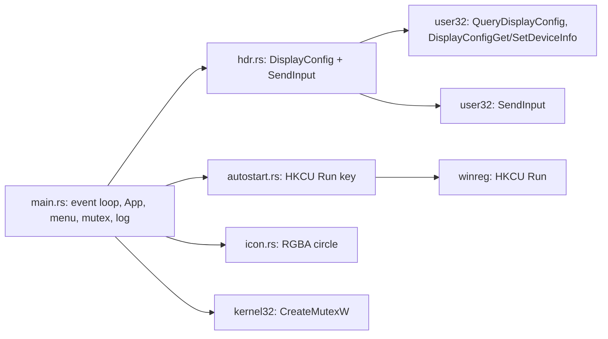
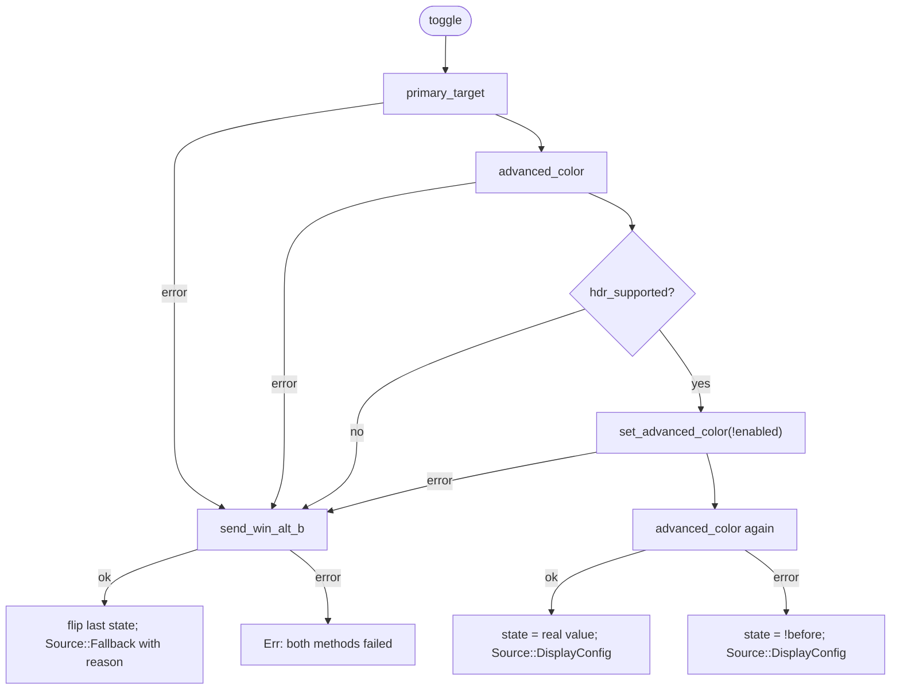

# Architecture

This document explains how `hdr_toggle` works internally. For build and usage instructions,
see the [README](../README.md).

## Contents

1. [Overview](#overview)
2. [Modules](#modules)
3. [Startup and event flow](#startup-and-event-flow)
4. [HDR detection and switching](#hdr-detection-and-switching)
5. [The Win + Alt + B fallback](#the-win--alt--b-fallback)
6. [App state](#app-state)
7. [Start with Windows](#start-with-windows)
8. [Single instance](#single-instance)
9. [Icon generation](#icon-generation)
10. [Error handling and logging](#error-handling-and-logging)
11. [Unsafe code inventory](#unsafe-code-inventory)
12. [Dependencies and features](#dependencies-and-features)
13. [Design decisions](#design-decisions)

---

## Overview

`hdr_toggle` is a single-threaded tray app. A `tao` event loop runs on the main thread.
`tray-icon` (with its bundled menu crate `muda`) provides the notification-area icon and
context menu. All Windows-specific work goes through the official `windows` crate or
`winreg`.



`main.rs` is the only module that logs. The other modules return `anyhow::Result` and leave
reporting to the caller.

## Modules

| File | Responsibility | Public API |
| --- | --- | --- |
| `src/main.rs` | Entry point, single-instance guard, event loop, tray and menu, event handling, logging | (binary) |
| `src/hdr.rs` | Read and set HDR on the primary display; Win + Alt + B fallback | `HdrState`, `Source`, `current()`, `toggle()` |
| `src/autostart.rs` | Read, add, and remove the HKCU Run value | `is_enabled()`, `set(bool)` |
| `src/icon.rs` | Build the tray icon from generated pixels | `make_icon(on: bool)` |

## Startup and event flow

```mermaid
sequenceDiagram
    participant Main as main/run
    participant Mutex as SingleInstance
    participant Loop as tao EventLoop
    participant App
    participant Tray as tray-icon/muda
    Main->>Mutex: acquire()
    alt mutex already exists
        Mutex-->>Main: None
        Main->>Main: return Ok (exit silently)
    end
    Main->>Loop: build with UserEvent
    Main->>Tray: set_event_handler (tray + menu) forwarding to EventLoopProxy
    Main->>App: App::new() reads HDR state + autostart state
    Main->>Loop: run(closure)
    Loop->>App: NewEvents(Init) then init_tray()
    App->>Tray: TrayIconBuilder ... build()
    Tray-->>Loop: UserEvent::Tray / UserEvent::Menu
    Loop->>App: on_tray_event / on_menu_event
    App-->>Loop: false on Quit or tray failure
    Loop->>Loop: drop tray, ControlFlow::Exit
```

Key points:

- **Event forwarding.** `tray-icon` and `muda` deliver events through global handlers that
  may run on another thread. `forward_events()` installs handlers that wrap each event in
  `UserEvent::Tray` / `UserEvent::Menu` and send it through an `EventLoopProxy`. Every
  handler therefore runs on the main thread, which `muda` and `tray-icon` objects require
  because they are not thread-safe.
- **Tray creation at `StartCause::Init`.** The tray is built once the loop has started,
  following the `tray-icon` examples.
- **Left-click vs. right-click.** `with_menu_on_left_click(false)` keeps left-click free for
  toggling. The app reacts to `Click { button: Left, button_state: Up }`, so each click
  toggles once (on release). Right-click opens the context menu (tray-icon's default).
- **Hover refresh.** `TrayIconEvent::Enter` calls `App::refresh()`, which re-reads the HDR
  state (only when not in fallback mode) and updates the icon if it changed.
- **Shutdown.** Handlers return `bool`, where `false` means "quit". The loop then sets
  `app.tray = None`, which removes the icon right away, and sets `ControlFlow::Exit`. The
  mutex guard is moved into the loop closure, so it lives as long as the loop. The OS
  releases it at process exit.
- **Control flow.** `ControlFlow::Wait`: the app sleeps until an event arrives and uses no
  CPU when idle.

## HDR detection and switching

All of this lives in `src/hdr.rs` and uses only documented DisplayConfig APIs.

### 1. Finding the primary display

`primary_target()`:

1. `GetDisplayConfigBufferSizes(QDC_ONLY_ACTIVE_PATHS)` returns how many paths and modes to
   allocate.
2. `QueryDisplayConfig(QDC_ONLY_ACTIVE_PATHS, ...)` fills them. If the display topology
   changes between the two calls, Windows returns `ERROR_INSUFFICIENT_BUFFER`, and
   `query_active_config()` retries up to 3 times.
3. For each path, the app looks for the **source mode** (`infoType ==
   DISPLAYCONFIG_MODE_INFO_TYPE_SOURCE`) with the same `adapterId` + `id` as the path's
   source. The primary display is the one whose source mode `position` is `(0, 0)`, which is
   how Windows defines the primary desktop.
4. If no path matches, the first active path is used.
5. The result is the path's **target** (`targetInfo.adapterId`, `targetInfo.id`), which is
   what the advanced-color requests address.

### 2. Reading the state

`advanced_color()` sends `DISPLAYCONFIG_DEVICE_INFO_GET_ADVANCED_COLOR_INFO` (type 9) through
`DisplayConfigGetDeviceInfo`. The reply's bitfield is decoded as:

| Bit | Field (wingdi.h) | Used as |
| --- | --- | --- |
| 0 | `advancedColorSupported` | must be set for HDR to count as supported |
| 1 | `advancedColorEnabled` | HDR on, if supported |
| 2 | `wideColorEnforced` | if set, this is SDR Auto Color Management, **not HDR**, so the display counts as unsupported |
| 3 | `advancedColorForceDisabled` | if set, advanced color is blocked (for example by policy), so unsupported |

```text
hdr_supported = supported && !force_disabled && !wide_color_enforced
hdr_enabled   = hdr_supported && enabled
```

`current()` returns an error if `hdr_supported` is false. That error is what puts the app
into fallback mode at startup.

### 3. Setting the state

`set_advanced_color()` sends `DISPLAYCONFIG_DEVICE_INFO_SET_ADVANCED_COLOR_STATE` (type 10)
through `DisplayConfigSetDeviceInfo`, with bit 0 (`enableAdvancedColor`) set to the
desired value.

### 4. Toggle sequence



**Once `set_advanced_color` succeeds, the code never falls back.** If the follow-up read
fails, it assumes the switch worked. Falling back at that point would send Win + Alt + B and
switch HDR a second time, undoing the change.

### 5. Why the structs are defined manually

The `windows` crate has `DISPLAYCONFIG_GET_ADVANCED_COLOR_INFO` and
`DISPLAYCONFIG_SET_ADVANCED_COLOR_STATE`, but:

- the GET struct only exists when the extra `Win32_Graphics_Gdi` feature is enabled (its
  `colorEncoding` field type lives there), and
- both expose the bitfield as an anonymous union, so every read would need an extra
  `unsafe` block.

`hdr.rs` therefore defines two minimal `#[repr(C)]` structs that follow the documented
wingdi.h layout and reuse the crate's `DISPLAYCONFIG_DEVICE_INFO_HEADER`:

```rust
#[repr(C)]
struct GetAdvancedColorInfo {          // DISPLAYCONFIG_GET_ADVANCED_COLOR_INFO
    header: DISPLAYCONFIG_DEVICE_INFO_HEADER,
    flags: u32,                        // the bitfield union, as a plain u32
    _color_encoding: i32,              // DISPLAYCONFIG_COLOR_ENCODING
    _bits_per_color_channel: u32,
}

#[repr(C)]
struct SetAdvancedColorState {         // DISPLAYCONFIG_SET_ADVANCED_COLOR_STATE
    header: DISPLAYCONFIG_DEVICE_INFO_HEADER,
    flags: u32,
}
```

The header's `size` field is set to the full struct size, so Windows reads or writes exactly
that many bytes. Pointers are made from the whole struct and then cast to the header type
(`(&mut info as *mut GetAdvancedColorInfo).cast()`), not from `&mut info.header`. A pointer to
just the header field would technically only allow access to the header itself.

## The Win + Alt + B fallback

`send_win_alt_b()` builds six keyboard `INPUT` records and sends them in one `SendInput`
call:

```
LWIN down, MENU (Alt) down, B down, B up, MENU up, LWIN up
```

One call keeps the sequence atomic, so no real keystrokes can be interleaved. If `SendInput`
reports fewer than 6 events injected (for example when UIPI blocks injection into an
elevated foreground window), it returns an error.

Win + Alt + B is the Windows HDR toggle shortcut. Windows handles it itself (it appears to go
through Xbox Game Bar), and it gives no feedback, so the app cannot know the result. It
therefore:

- flips its last known state (`fallback_last`),
- reports `Source::Fallback { reason }`, where `reason` is the error that kept the API path
  from being used,
- and `main.rs` marks the state as *assumed*, which adds "(assumed - fallback, state not
  read)" to the tooltip and logs the reason.

## App state

`App` in `main.rs` holds:

| Field | Meaning |
| --- | --- |
| `tray: Option<TrayIcon>` | `None` until `init_tray`, and again after Quit (dropping it removes the icon). |
| `items: MenuItems` | The four menu items, kept so their IDs can be matched against `MenuEvent`s. |
| `state: HdrState` | Current (or assumed) HDR state. Passed to `hdr::toggle` as `fallback_last`. |
| `assumed: bool` | `true` when `state` is tracked from fallback toggles rather than read from Windows. |

State transitions:

- **Startup:** `hdr::current()` succeeds, so `assumed = false` with the real state. If it
  fails, the error is logged and the app starts with `assumed = true`, `state = Off`.
- **Toggle via API:** `assumed = false`. This also restores normal mode after a successful API
  toggle, for example once an HDR display is attached.
- **Toggle via fallback:** `assumed = true`.
- **Hover (`Enter`)** while `assumed == false`: re-read the state. Failures here are ignored
  silently, so hovering never writes to the log.

## Start with Windows

`src/autostart.rs` uses `winreg` and contains no unsafe code.

- Key: `HKCU\Software\Microsoft\Windows\CurrentVersion\Run`; value name: `HDRToggle`.
- Value: the quoted path of `std::env::current_exe()`, for example `"C:\...\hdr_toggle.exe"`.
  Quoting keeps paths with spaces working.
- `is_enabled()` returns true only if the value exists and equals the current quoted exe path
  (ASCII case-insensitive). A missing value means `false`, not an error.
- `set(true)` writes the value; `set(false)` deletes it, and a missing value counts as
  success.
- The key is opened with only the access each operation needs (`KEY_QUERY_VALUE` or
  `KEY_SET_VALUE`).

Menu behaviour (`App::apply_autostart`): `muda` flips a `CheckMenuItem`'s checked state
**before** sending the click event, so `is_checked()` already holds the user's new choice.
The app writes that choice, then always re-reads the registry and sets the checkbox from it.
If the write failed, the checkbox snaps back to the real state.

## Single instance

`SingleInstance::acquire()` calls `CreateMutexW(None, false, "Local\\hdr_toggle_single_instance")`:

- The `Local\` prefix limits the mutex to the current logon session, so each signed-in user
  can run their own copy.
- If `GetLastError()` is `ERROR_ALREADY_EXISTS` right after the call, another instance owns
  it. The guard is dropped, which closes this handle, and `run()` returns `Ok(())`, so the
  second process exits with code 0 and logs nothing.
- Otherwise the guard (which closes the handle in `Drop`) is moved into the event loop closure
  and lives as long as the process.

## Icon generation

`src/icon.rs` draws a 32×32 RGBA image in memory; there are no image files.

- Circle centre `(15.5, 15.5)`, radius `14` px.
- For each pixel, `coverage = clamp(radius + 0.5 - distance, 0, 1)` gives a one-pixel
  anti-aliased edge; coverage becomes the alpha channel. RGB is the fill colour everywhere.
- Colours: green `#2EC24F` (on), gray `#808080` (off).
- `tray_icon::Icon::from_rgba(buffer, 32, 32)` turns the pixels into an icon. A new icon is
  generated on every state change; this is cheap.

## Error handling and logging

- Every fallible function returns `anyhow::Result` with context. There are no
  `unwrap`/`expect` calls, so a panic is not possible in normal use.
- Win32 failures are turned into readable messages by `win32_error()`, which wraps the code
  in `windows::core::Error` to get the system message (for example
  `QueryDisplayConfig failed: The parameter is incorrect. (0x80070057)`).
- `log_error()` in `main.rs` appends `[YYYY-MM-DD HH:MM:SS UTC] <error chain>` to
  `%LOCALAPPDATA%\hdr_toggle\log.txt`, creating the folder if needed. The error chain is
  printed with `{:#}`, so context layers read `outer: inner`.
- The timestamp is computed from `SystemTime` with a small days-to-date conversion
  (`civil_from_days`), so no date crate or extra Win32 call is needed. UTC is used for
  the same reason.
- Logging failures (for example a read-only folder) are ignored on purpose. The logger never
  stops the app.

What happens when something fails:

| Failure | Behaviour |
| --- | --- |
| Reading HDR state at startup | Logged; start in fallback (assumed) mode. |
| Toggle via API | Use the fallback silently, then log the reason. |
| Toggle via API and fallback | Logged; state unchanged. |
| Building or updating the icon/tooltip | Logged; the app keeps running. |
| Creating the tray icon | Logged; the app exits (it has no other UI). |
| Registry read/write | Logged; the checkbox re-syncs to the registry. |
| Opening Display Settings | Logged. |
| Creating the mutex | Logged by `main`; the app exits. |

## Unsafe code inventory

All `unsafe` is confined to small, safe wrapper functions, each with a `// SAFETY:` comment.
Callers never see raw pointers.

| Function | File | Unsafe operation | Why it is sound |
| --- | --- | --- | --- |
| `source_position` | hdr.rs | Read union `mode.Anonymous.sourceMode` | Only after checking `infoType == SOURCE`, which marks that member as active. |
| `buffer_sizes` | hdr.rs | `GetDisplayConfigBufferSizes` | Out-pointers are live local `u32`s. |
| `query_display_config` | hdr.rs | `QueryDisplayConfig` | Counts passed never exceed buffer lengths; topology pointer is null, as required with `QDC_ONLY_ACTIVE_PATHS`. |
| `advanced_color` | hdr.rs | `DisplayConfigGetDeviceInfo` | `#[repr(C)]` struct begins with the header; `header.size` = full struct size. |
| `set_advanced_color` | hdr.rs | `DisplayConfigSetDeviceInfo` | Same as above (read-only for the API). |
| `send_win_alt_b` | hdr.rs | `SendInput` | Fully initialized `INPUT` slice; `cbSize = size_of::<INPUT>()`. |
| `create_named_mutex` | main.rs | `CreateMutexW`, `GetLastError` | Static NUL-terminated name (`w!`), no security attributes; last error read straight after the call. |
| `close_handle` | main.rs | `CloseHandle` | Handle owned exclusively by `SingleInstance`, closed once in `Drop`. |

Building `INPUT` values with union fields (`key_input`) is safe Rust. Only *reading* a union
needs `unsafe`.

## Dependencies and features

| Crate | Version | Used for |
| --- | --- | --- |
| `windows` | =0.62.2 | Win32 APIs (see features below) |
| `tray-icon` | =0.26.1 | Notification-area icon; re-exports `muda` as `tray_icon::menu` |
| `tao` | =0.37.1 | Event loop and cross-thread event proxy |
| `winreg` | =0.56.0 | HKCU Run key |
| `anyhow` | =1.0.104 | Error type with context |

`windows` features (only these are enabled):

| Feature | Provides |
| --- | --- |
| `Win32_Foundation` | `LUID`, `HANDLE`, `WIN32_ERROR`, `CloseHandle`, `GetLastError`, error constants |
| `Win32_Devices_Display` | `QueryDisplayConfig`, `GetDisplayConfigBufferSizes`, `DisplayConfigGet/SetDeviceInfo`, `DISPLAYCONFIG_*` types |
| `Win32_UI_Input_KeyboardAndMouse` | `SendInput`, `INPUT`, `KEYBDINPUT`, virtual-key codes |
| `Win32_System_Threading` | `CreateMutexW` |
| `Win32_Security` | Needed by the `CreateMutexW` signature (`SECURITY_ATTRIBUTES`) |

## Design decisions

- **`tao` over `winit`.** `tray-icon` is developed alongside `tao` (both from the Tauri
  project), and its examples use it, so it is the best-tested pairing.
- **DisplayConfig first, shortcut second.** The API can read the real state; the shortcut
  can't. The shortcut exists only so the app still does *something* where the API fails.
- **Treat "wide color enforced" as not HDR.** Otherwise, toggling on an SDR display using
  Auto Color Management would switch ACM rather than HDR, and the icon would mislead.
- **`explorer.exe ms-settings:display` instead of `ShellExecuteW`.** Opening Settings needs no
  `unsafe` code and no extra `windows` feature this way. Explorer hands the URI to the
  Settings app and exits quickly; its exit code is not meaningful, so it is ignored.
- **Tooltip instead of toast.** `tray-icon` has no balloon/toast support; a toast would need
  extra WinRT features and an app identity.
- **Console hidden only in release.** `#![cfg_attr(not(debug_assertions), windows_subsystem = "windows")]`
  keeps a console for debug builds (handy for panics) and none for release.
- **Local logging, no log crate.** A dozen lines in `main.rs` cover the single requirement
  (append errors to a file), with no extra dependency.
